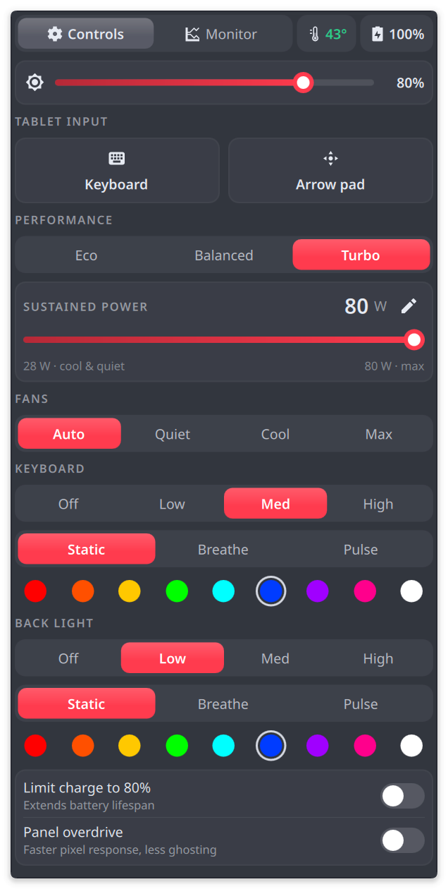

# ROG Flow Z13 (2025) on Linux: Z13 Control

An Armoury Crate-style control panel for the **ASUS ROG Flow Z13 (2025, GZ302)** on **Fedora KDE Plasma**. It's a Plasma widget with power modes that actually change the power settings, fan presets, the keyboard and rear light bar, live system monitoring, and tablet-mode helpers (an on-screen keyboard button and a floating arrow pad).

<p align="center"></p>

## Features

- **Eco / Balanced / Turbo** that set everything together, like Armoury Crate:

  | | Eco | Balanced | Turbo |
  |---|---|---|---|
  | CPU power limit (sustained / boost / fast) | 40 / 50 / 60 W | 60 / 75 / 86 W | 80 / 92 / 93 W |
  | CPU boost | off | on | on |
  | CPU energy preference | power | balanced | performance |
  | System power profile | power-saver | balanced | performance |
  | Screen refresh rate | 60 Hz | 180 Hz | 180 Hz |

- **Sustained power slider** (28–80 W) for anything in between.
- **Fan presets:** Auto, Quiet, Cool, Max.
- **Keyboard backlight:** brightness, effect (static, breathe, pulse) and colour.
- **Rear light bar:** brightness, effect and colour. asusd doesn't support the bar on this model, so the widget drives it directly and restores it after boot and resume.
- **Tablet input:**
  - **Keyboard** opens the on-screen keyboard for the app you're in.
  - **Arrow pad** opens a small floating ↑ ← ↓ → pad. It's handy in terminals, where the on-screen keyboard has no arrow keys. It doesn't take focus from your app, it repeats when held, and it stays where you drag it.
- **Monitor tab:** CPU, GPU, memory and package power graphs, temperatures, fan speeds, and an estimate of battery time left or time to full.
- **Charge limit 80%** and **panel overdrive** toggles, plus screen brightness.
- Controls respond the moment you tap them, while the hardware catches up in the background.

## Requirements

- **ASUS ROG Flow Z13 2025 (GZ302EA)**, any memory size (32 / 64 / 128 GB), any CPU (Ryzen AI Max 385 / 390 / 395)
- **Fedora 44 KDE Plasma** (Plasma 6.7, kernel 7.x with the `asus-armoury` driver)
- **asusctl / asusd 6.3.x** (the installer gets it from the [asus-linux COPR](https://copr.fedorainfracloud.org/coprs/lukenukem/asus-linux/))

Other distros and other ASUS models are untested. The backend talks to asusd and the hardware directly, so model differences matter.

## Install

```bash
git clone https://github.com/morrob955/rog-flow-z13-linux.git
cd rog-flow-z13-linux
./install.sh
```

Run it as your normal user; it asks for `sudo` when it needs it. It:

1. installs `asusctl` (enabling the asus-linux COPR), `ydotool` and the KDE pieces the widget uses, then enables `asusd`
2. adds two udev rules that give the logged-in user access to the rear light bar and `/dev/uinput` (for the arrow pad)
3. installs the widget with `kpackagetool6`
4. enables two user services: `ydotoold` (arrow pad) and `z13-rear` (restores the light bar)

Then right-click the panel → **Add or Manage Widgets** → **Z13 Control**. It opens as a floating panel; you can also bind it to a key in System Settings → Keyboard → Shortcuts (search "Z13").

**Update:** `git pull && ./install.sh`, then log out and back in.
**Uninstall:** `./install.sh --uninstall` (packages are left installed).

## Optional system fixes

`fixes.sh` is separate from the widget and changes system files, so read it before running it:

```bash
sudo bash fixes.sh          # apply, then reboot
sudo bash fixes.sh --undo   # revert, then reboot
```

- **Quiet speakers:** switches the CS35L41 amps to the 19.5 dB config that ships in linux-firmware, instead of the 15.5 dB one Linux picks. Speaker protection stays on.
- **Screen flicker:** disables eDP Panel Self Refresh and Panel Replay (`amdgpu.dcdebugmask=0x410`). This costs a little idle battery.
- **Waking in your bag:** stops the folded keyboard from waking the machine over USB. The lid and the power button still wake it.

## Troubleshooting

| Symptom | Check |
|---|---|
| Power or fan controls do nothing | `systemctl status asusd` and `asusctl --version` (needs 6.3.x) |
| Mode changes but boost/EPP don't follow | `busctl --system get-property org.freedesktop.UPower.PowerProfiles /org/freedesktop/UPower/PowerProfiles org.freedesktop.UPower.PowerProfiles ActiveProfile` |
| Arrow pad keys do nothing | `systemctl --user status ydotoold` and `getfacl /dev/uinput` (your user needs `rw`; log out and back in after installing) |
| Keyboard button does nothing | KWin only shows the on-screen keyboard after touch or pen input. Tap the button with your finger. |
| Rear light bar doesn't respond | `ls -l /etc/udev/rules.d/70-z13-rear.rules`, then replug or reboot |

## For AI assistants

[AGENTS.md](AGENTS.md) has step-by-step install, verification and troubleshooting instructions for coding agents (Claude Code, Codex, Gemini CLI, Cursor and others) helping someone set this up.

## Credits

- [asusctl / asusd](https://gitlab.com/asus-linux/asusctl) by the asus-linux project, which does the heavy lifting.
- The rear light bar wake sequence comes from asusctl PR #390.

## License

MIT. See [LICENSE](LICENSE).
